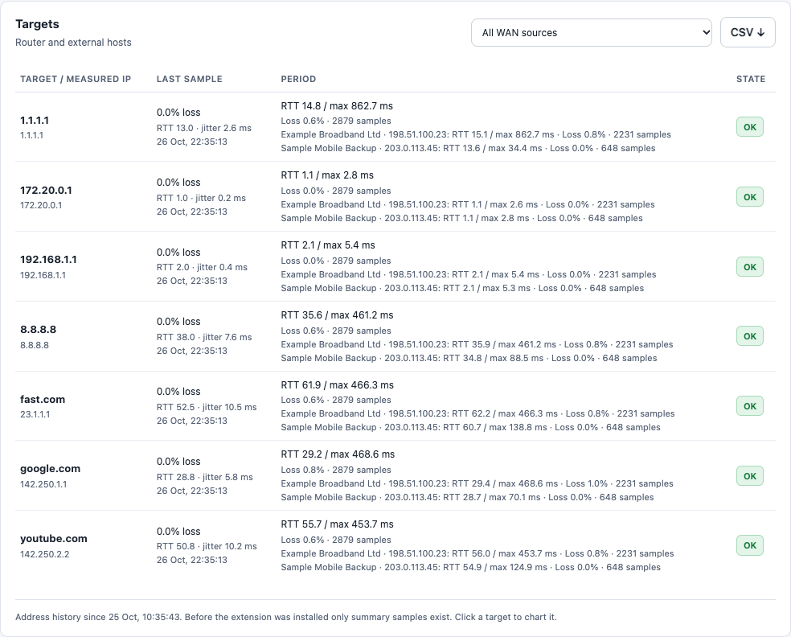
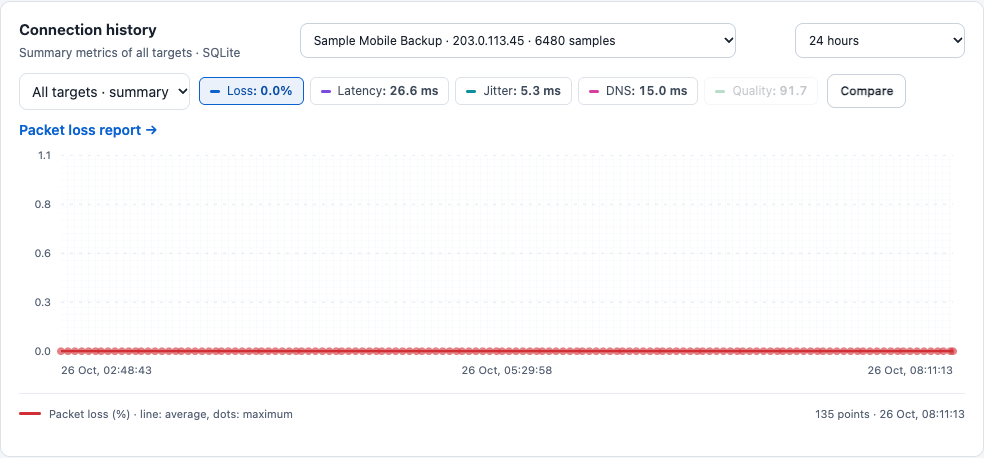
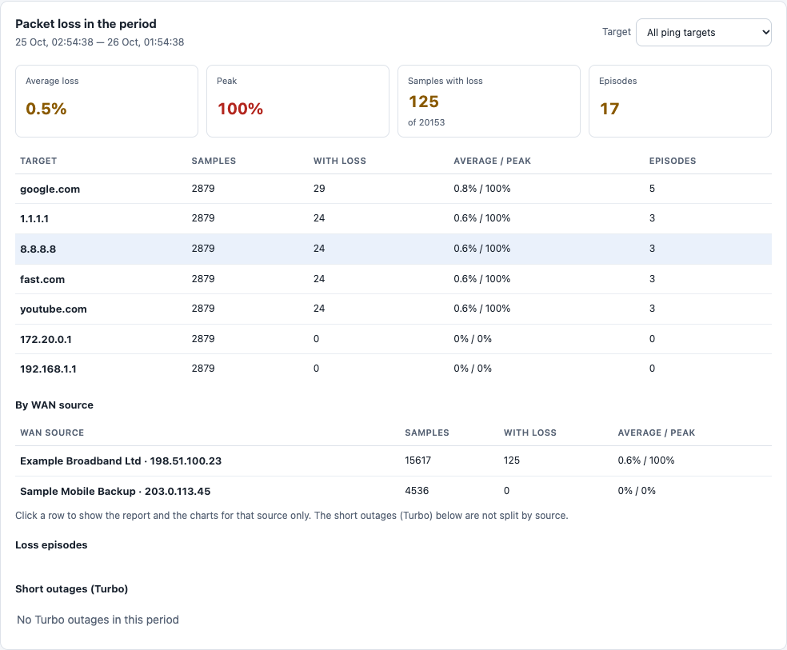
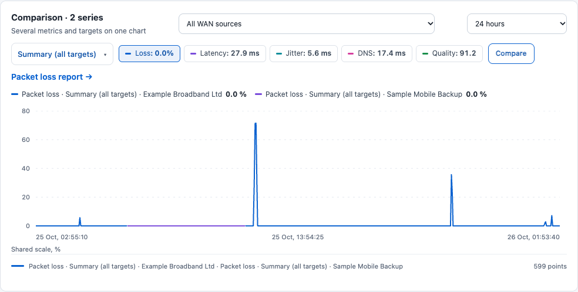
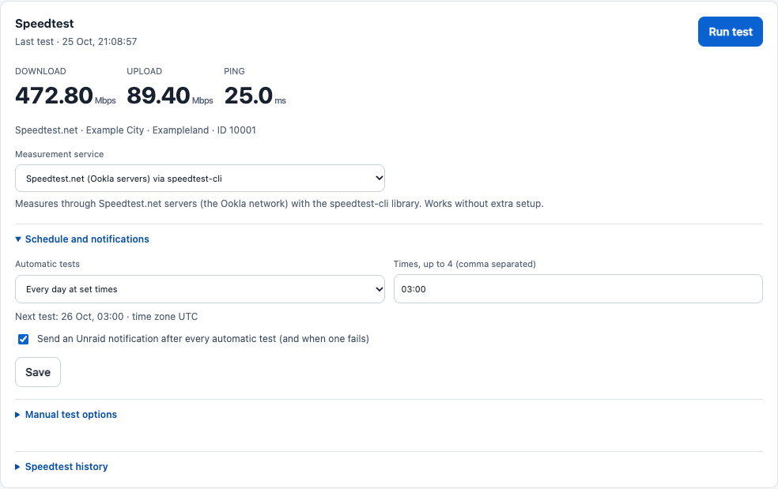
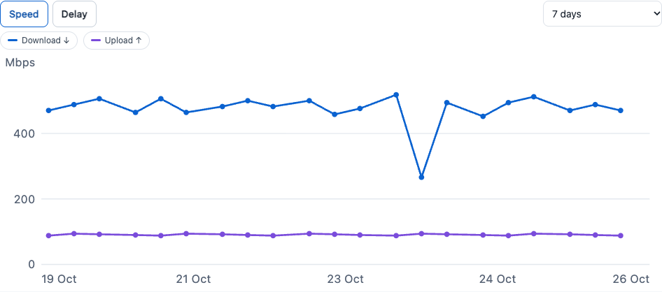
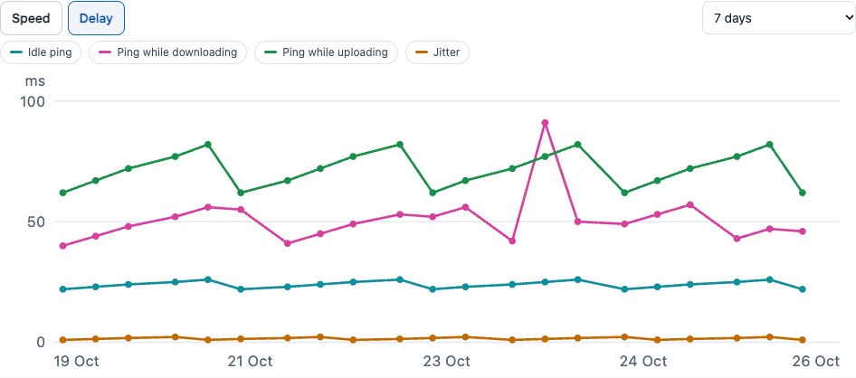
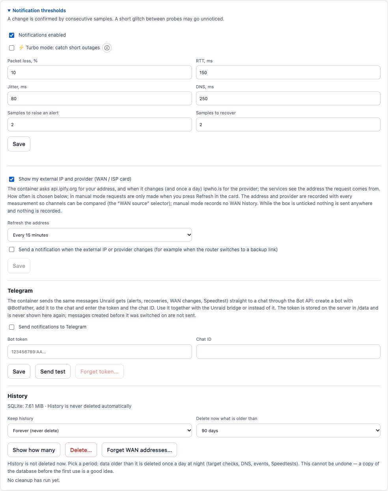
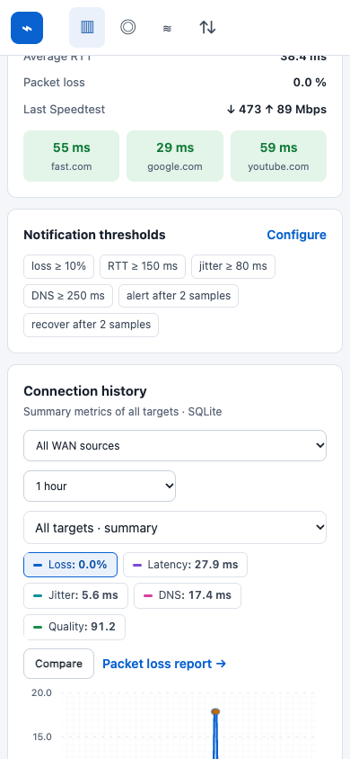
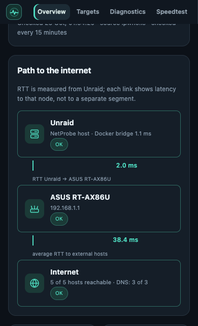

# Internet Health

*Formerly “NetProbe Enhanced”.* Internet monitoring for Unraid (and any Docker host), built on [NetProbe](https://github.com/bmartino1/NetProbe_Python):
per-target history, a packet-loss report, a WAN / ISP view, Speedtest with a chart, and **readable notifications** to Telegram and/or Unraid
(email and every Unraid agent) — plus a modern dashboard with two styles (dark *NetProbe* and light/dark *UniFi*) and a Russian/English switch.

It ships as a **ready container image**, `ghcr.io/d1-m4ss/internet-health`: the NetProbe image (pinned by digest) with this project's files
inside. Install it from the Unraid template or a compose file — nothing to copy or mount besides the data folder — and configure everything in the
web UI. It adds its own tables (`np_*`) next to NetProbe's and leaves NetProbe's untouched, so the stock app still works on the same data.

> Internet Health is an independent project and is not affiliated with or endorsed by the author of NetProbe.
> The screenshots show invented data (a fictional ASUS router at 192.168.1.1), generated by
> [`tests/demo_server.py`](tests/demo_server.py).

[Русская версия](README.ru.md)


| | |
|---|---|
|  |  |

## What you get

- **History per target and per measured IP** (SQLite, additive `np_*` tables — the upstream tables keep their structure; rows are removed only when you choose a retention period, see *History retention* below).
  The upstream app only keeps aggregates.
- **Alerts that explain themselves.** Instead of `google.com: DOWN`, the notification says what is wrong:
  *Router is not responding*, *No internet*, *Names do not resolve (DNS)*, *Unreachable: Google*, with icons,
  a hint what to check and, on recovery, how long the problem lasted. See [docs/NOTIFICATIONS.md](docs/NOTIFICATIONS.md).
- **No notification floods.** A change needs 2 consecutive bad samples; a steady outage sends one message, not
  one per probe; a target that keeps flapping is muted and summarised. 3 hours of flapping produce 5–6 messages
  instead of hundreds (see the simulator below).
- **Turbo mode (opt-in) for short outages.** A light watcher pings the router and two internet IPs every 5 s and
  reports outages from about 10 s that the regular checks miss: one message after recovery with the duration, at
  most 3 per hour, and silence when the regular monitor already alerted. Off by default; ⓘ in the settings explains it.
- **Scheduled Speedtest with a notification.** In the *Speedtest* tab: off, every N hours, or every day at set times
  (for example 03:00); optionally one Unraid message with the result (or the reason it failed) after every automatic
  test. Without changes the container variables `SPEEDTEST_ENABLED` / `SPEEDTEST_INTERVAL` keep deciding.
- **A *WAN / ISP* card with your external IP, on request.** Tick *Show my external IP and provider* in the settings
  and a card under the status banner shows the address the internet sees and your provider's name. Off by default:
  nothing is requested and nothing recorded until you tick it; then the container asks `api.ipify.org`
  for the address (one tiny request) and `ipwho.is` for the provider name only when the address changes and once a
  day. How often is your choice: every 15 minutes (default), every minute, or **manually** — then nothing is requested
  until you press *Refresh* in the card (manual mode records no WAN history and sends no change notifications). The
  services see the address the request comes from.
- **WAN history and a WAN selector.** With that option on, every measurement is stored together with the address and
  provider that carried it, so a failover to a backup link or a provider change can be told apart in the data: a
  *WAN source* selector above the chart and in the *Targets* table (kept in sync) shows the history, statistics and
  per-target breakdown of one source (the overall quality score is not drawn for a single WAN, it belongs to the
  whole network). Recorded addresses are deleted with the rest of the history by the retention period, or at once with
  *Forget WAN addresses…*. The chosen period, WAN source and metric are remembered in your browser, so the next visit
  starts where you left off.
- **Integrations: Unraid and Telegram.** Settings → *Integrations* has a switch for each channel: **Unraid** (the notification bridge
  on the host; switching it off makes Unraid stop receiving events, switching it on again does not replay old ones) and **Telegram**
  straight from the container, or both, or neither (history and charts are recorded either way). Ticking Telegram shows the bot token
  (from @BotFather) and chat ID fields, *Send test*, Save; values given to the container as variables are not shown. The container then sends the same messages Unraid gets (alerts, recoveries, WAN changes, Speedtest
  results) to the chat through the Bot API — together with the Unraid bridge or without it. The token is stored in
  `/data/telegram.json` (mode 600), is never shown again by the UI or the API (nor is the chat ID: an empty field keeps the saved value), and can instead be given to the container as
  `TELEGRAM_BOT_TOKEN` / `TELEGRAM_CHAT_ID`. Messages from before it was switched on are not sent; a failed delivery is
  retried with a growing pause and given up after a day.
- **The loss report and the compare chart know the WAN source.** The *WAN source* choice also limits the *Packet loss* report, and a
  table in it shows how each source fared (probes, probes with loss, average / maximum; a click selects that source). In the compare
  chart *One line per WAN source* draws every picked series once per source — for example the loss of the summary through your main
  link and through the backup on one plot. The pinned menu on a phone is a single row now (about 47 px instead of 90–100).
- **A message when the WAN changes.** Optional (*Send a notification when the external IP or provider changes*): one
  Unraid message with before and now — a warning when the provider changed (typically a switch to a backup link), an
  information message when only the address changed — confirmed by two checks in a row, at most 6 per hour.
- **Database backups from the page.** Settings → *History* → *Back up now* writes a complete, consistent copy of the database while
  monitoring keeps running (`/data/db-backups`, the 5 newest are kept); each copy can be downloaded or deleted there. Deleting history
  by hand makes a copy first and stops if it cannot. Restoring: [docs/INSTALL-UNRAID.md → Restoring a backup](docs/INSTALL-UNRAID.md#restoring-a-backup).
- **History retention (off by default).** The database grows without limit unless you say otherwise. In the settings
  choose to keep history for 7 / 30 / 90 / 180 days or 1 year: older records (target checks, DNS, events, Speedtests,
  delivered notifications) are then deleted once a night, in small batches, and the file is compacted. You can also
  preview and delete on demand with a confirmation showing the number of records. Undelivered notifications, open
  outages and the current state are never deleted. Deletion is irreversible: keep a copy of the database first.
- **Packet-loss report for any period** — summary, per-target table and a list of loss episodes; click an
  episode to zoom the chart onto it. Periods from 1 minute to a month, or a custom *from–to* window.
- **Compare mode** — several metrics and several targets (for example all DNS servers) on one chart, with a
  shared scale when the units match and a per-series scale otherwise.
- **Path to the internet:** Unraid → router → Internet, drawn from the real targets, with measured RTT on the links.
- **Speedtest chart, jitter and delay under load.** The *Speedtest* tab draws the results over 24 hours, 7 days, 30 days or all
  time — speed (download ↓ and upload ↑), delay (idle ping, ping while downloading and while uploading, jitter) or packet loss
  (when the service measures it). Every line has a button to show or hide it, one service at a time is drawn (the newest test's
  by default), and hovering a point shows its values, the service and the server. Fast.com also measures the delay under load
  (bufferbloat), and the numbers appear next to each test. An unmeasured value is a gap in the line, never a zero. The history
  table under the chart lists the newest tests first: the last 10, the chart's period, or all.
  Optional messages after manual tests, and a warning when the speed falls 20 / 30 / 50 % below the 7-day median of the same service.
- **Speedtest service of your choice.** The *Speedtest* tab says which service measures: Speedtest.net (Ookla servers,
  through speedtest-cli — the default), the official Ookla CLI (when you install its binary in the container) or
  **Fast.com (Netflix)**, measured by NetProbe itself — no account, key or extra software. The choice applies to
  manual and scheduled tests and is stored in `/data/netprobe-prefs.json`.
- **Two UI styles, two languages** chosen from drop-downs (remembered in the browser). One self-contained HTML
  file: no CDN, no external fonts, works offline on your LAN.
- **Safe by construction:** Internet Health sends messages only through Unraid's own `notify` and, if you configure it,
  to your own Telegram chat. The only other outbound requests are the ones you ask for: the Speedtest you run or schedule (speedtest.net, Ookla or fast.com
  / Netflix servers, depending on the chosen service) and, only with the checkbox ticked, the public-IP / ISP lookup. The
  container gets no extra privileges, no Docker socket and no host mounts besides its data folder.


















On a phone the menu bar stays pinned to the top while the page scrolls:





## How it works

```
 probe cycle (~50 s)           SQLite (/data)                    destinations (Settings → Integrations)
 ┌────────────────────┐   ┌────────────────────────────┐   ┌─────────────────────────────────────────┐
 │ Internet Health    │──▶│ NetProbe tables (unchanged)│   │ Telegram: sent straight from the        │
 │ container          │   │ np_targets  np_state       │──▶│ container (Bot API)                     │
 │ (NetProbe + the    │   │ np_events  np_notifications│   ├─────────────────────────────────────────┤
 │  extension)        │   │ np_speedtest_extra …       │   │ Unraid: the host bridge (cron, 1 min)   │
 └────────────────────┘   └────────────────────────────┘◀──│  GET /api/notifications/pending         │
        ▲ web UI :8788        db-backups/ (copies)          │  → Unraid `notify` (mail + agents)      │
                                                            └─────────────────────────────────────────┘
```

More detail: [docs/ARCHITECTURE.md](docs/ARCHITECTURE.md).

## Requirements

- A Docker host (Unraid is the main target; the image is `linux/amd64`). Nothing else is needed on the host for the web UI, the history, the Speedtest and
  Telegram.
- **Unraid notifications** (email, any Unraid agent) additionally need the small bridge script on the Unraid host (`curl`, `jq`, `flock`, `bash` — all on stock Unraid) and
  notification agents configured in *Settings → Notification Settings*. It is optional: Telegram needs no host setup.

The image is built on `bmmbmm01/netprobe@sha256:386bdc2c177b11aef4a1223dfd91ae47fe2f9804c5449c5f4c2caae1d048c155` (Python 3.14, Flask 3.1); CI checks that
base on every build. Running the files on another NetProbe image may need `src/app.py.patch` re-applied — see [upstream/UPSTREAM.md](upstream/UPSTREAM.md).

## Install

**Unraid** — one template, then everything in the web UI:

```sh
wget -O /boot/config/plugins/dockerMan/templates-user/my-InternetHealth.xml \
  https://raw.githubusercontent.com/d1-m4ss/internet-health/main/docs/unraid/internet-health.xml
```

*Docker → Add Container → Template: InternetHealth* → set the router IP, the sites to ping (keep **two IP addresses** next to the names: they tell "DNS is
down" from "the internet is down"), the time zone → *Apply* → open `http://<unraid>:8788`. Then *Settings → Integrations*: add Telegram and/or install the
Unraid bridge. Step by step, with checks: **[docs/INSTALL-UNRAID.md](docs/INSTALL-UNRAID.md)**.

**Docker compose** — [`examples/docker-compose.image.yml`](examples/docker-compose.image.yml), guide: **[docs/INSTALL-COMPOSE.md](docs/INSTALL-COMPOSE.md)**.

**Already running NetProbe, or the earlier "three files" install?** Change the container's repository to the image and drop the file mounts; your data stays
(**[docs/INSTALL-UNRAID.md → Switching](docs/INSTALL-UNRAID.md#switching-from-a-netprobe--files-install)**). The old file-mount way still works for running an unreleased version
(appendix of the same guide).

## Updating

Releases are numbered ([semver](https://semver.org)) and published with notes on the [Releases page](https://github.com/d1-m4ss/internet-health/releases) and in
[CHANGELOG.md](CHANGELOG.md); the version is shown in the page footer and by `GET /api/about`. On Unraid use *Check for updates → Update* (the template follows
`:latest`; set a tag such as `:1.1.0` to stay on one version), with compose `docker compose pull && docker compose up -d`. The data folder is untouched and
a new feature stays off until you switch it on. Make a copy first with *Settings → History → Back up now* if you like; going back is a matter of the previous tag.
Details: [docs/INSTALL-UNRAID.md → Updating](docs/INSTALL-UNRAID.md#updating).

## Configuration

| Variable (container) | Meaning |
|---|---|
| `ROUTER_IP` | router address; becomes the *Router* node and the first thing blamed when it does not answer |
| `ROUTER_NAME` | label used in the UI and in notifications (default `Router`, e.g. `ASUS RT-AX86U`) |
| `SITES` | comma-separated ping targets; include 1–2 IP addresses besides names |
| `DNS_NAMESERVER_n` / `_IP` | DNS servers probed (existing upstream variables) |
| `PROBE_INTERVAL`, `PING_COUNT` | unchanged upstream behaviour (default 30 s, 4 pings) |
| `SPEEDTEST_ENABLED`, `SPEEDTEST_INTERVAL`, `SPEEDTEST_BACKEND` | upstream behaviour (`python`, `ookla`, and now `fast`); the *Speedtest* tab can override service and schedule, see [docs/NOTIFICATIONS.md](docs/NOTIFICATIONS.md) |
| `APP_TIMEZONE` | zone of the daily Speedtest times (default `UTC`) |
| `TELEGRAM_BOT_TOKEN`, `TELEGRAM_CHAT_ID` | optional: Telegram delivery without the UI form (both needed; they win over the saved values and switch it on) |
| `GUNICORN_CMD_ARGS` | already `--threads 4` in the Internet Health image (the stock NetProbe image runs one single-threaded worker); never raise `--workers`: every worker would start its own probe loop |

Alert thresholds (loss ≥ 10 %, RTT ≥ 150 ms, jitter ≥ 80 ms, DNS ≥ 250 ms, 2 samples to alert, 2 to recover) are
edited in the UI (*Notifications* tab / *Notification thresholds*) or in `/data/alert-settings.json`.

## Try it, test it, break it — without sending anything

```sh
python -m venv .venv && . .venv/bin/activate && pip install -r requirements.txt
python -m unittest discover -s tests          # unit + integration tests (real Flask app, real bridge script)
python tests/simulate_network.py -v           # real probe loop + queue + bridge on a virtual clock, fake ping/DNS
npm install && npx playwright install chromium && node tests/test_ui.cjs   # browser tests, both styles/languages
node tests/test_mobile_nav.cjs && node tests/test_speedtest_ui.cjs          # pinned menu on phones; Speedtest service, schedule, public IP
```

The simulator runs 20 failure scenarios (outage, DNS-only outage, router down, flapping, restarts, a dead
notifier, …) through the real code and a fake `notify`; **no real notification or network request is made**.
`CHROME_PATH=/path/to/chrome` makes the UI test use an installed browser.

To look at the dashboard without Unraid or a real network, run `python tests/demo_server.py` and open
<http://127.0.0.1:8799> (add `--failing` to end with an outage). It runs the real app on invented data;
`node tests/screenshots.cjs` regenerates the pictures in `docs/screenshots`.


*(Demo data with a simulated internet outage, to show the colours — not a real outage.)*

## Security notes

- The web UI and API have **no authentication** (as upstream NetProbe). Keep port 8788 on your LAN; do not expose it. That includes the Telegram settings and the database backups, which anyone who can open the page can change or download.
- The settings and preferences endpoints (`/api/settings`, `/api/prefs`) accept only same-origin browser requests with an `X-NetProbe-Request` header.
- The notification queue is private to the host: `X-NetProbe-Notify-Key` (a random 256-bit token generated on
  first start in `/data/notify-token`, mode 600) is required to read or acknowledge it.
- Do not commit `/data` contents (database, token, settings) anywhere; see `.gitignore`.

## Limitations

- Probes are sequential (unchanged upstream design): a cycle takes about 50 s when everything answers (pings, DNS
  checks, then a 30 s pause) and about 100 s during an outage, because every dead target waits for its timeout.
  A change must be seen in **two consecutive cycles**, so an outage shorter than about 1.5 minutes is never reported
  and one of about 2.5 minutes (plus up to a minute for the cron bridge) always is. Setting `confirm_samples` to 1
  in the thresholds lowers that to about 40 s at the price of alerts for single blips. **Turbo mode** (off by
  default) catches outages from about 10 s instead; it costs about 9 MB of ICMP per day, and an ISP that rate-limits
  ICMP to *all* internet targets at once can cause a false report (one lost echo or one silent host is never enough).
  Its message waits for the regular cycle that was running at recovery (up to about 1.5 min) so the same outage is
  never reported twice.
- **Fast.com** numbers come from NetProbe's own client (latency, 8 connections for 8 s down, 4 for 8 s up against the
  closest Netflix servers); they can differ from the fast.com page, so compare a service with itself over time.
  The Speedtest.net backend keeps its upstream unit conversion (Mbit/s ÷ 1.048576). A scheduled test uses real
  bandwidth for about 20 s.
- Fast.com has no documented public API: the client uses the same endpoints as the fast.com page. If Netflix changes
  them, a Fast.com test fails with a readable message (and, when notifications are on, a warning) and the other
  services keep working.
- If the internet and the LAN are both completely down, Unraid cannot deliver email/Telegram. An external watcher
  is needed for a full-site outage.
- Real delivery through the Unraid agents is exercised only by your first real event; automated tests use a fake `notify`.
- Not tested on other Unraid / NetProbe versions, and the GitHub Actions workflow has not been run yet.

## License and credits

MIT — see [LICENSE](LICENSE). `src/app.py` is a modified copy of NetProbe_Python by Brandon Martino (MIT);
notices in [THIRD_PARTY_NOTICES.md](THIRD_PARTY_NOTICES.md).
