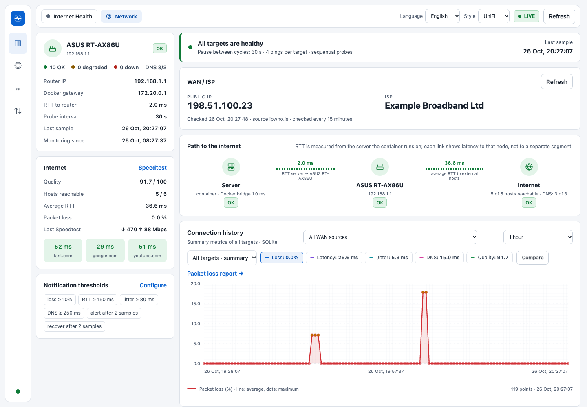
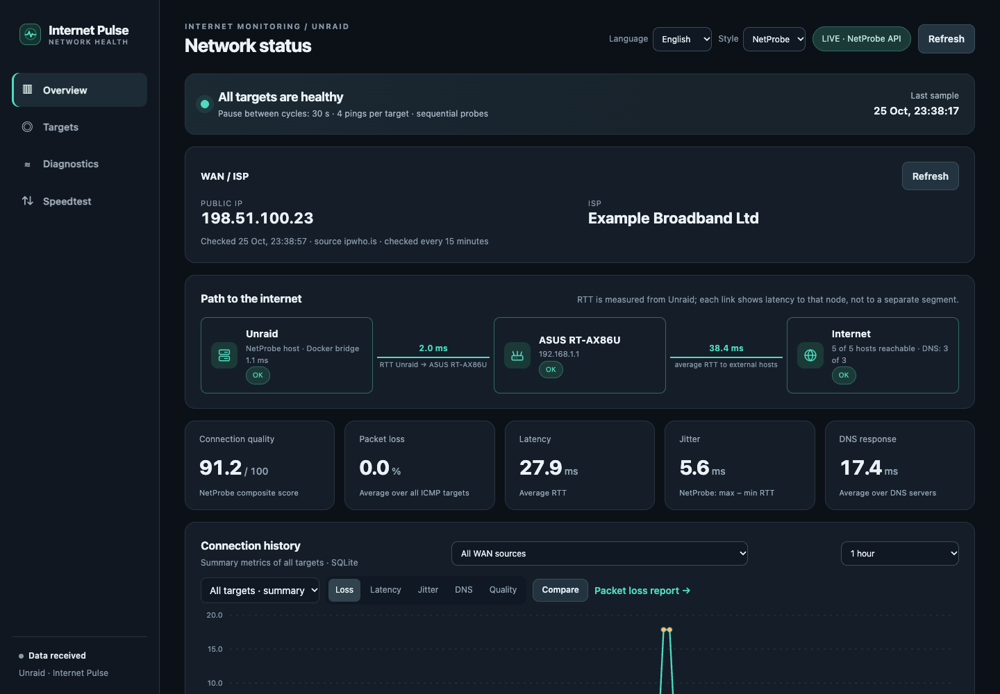
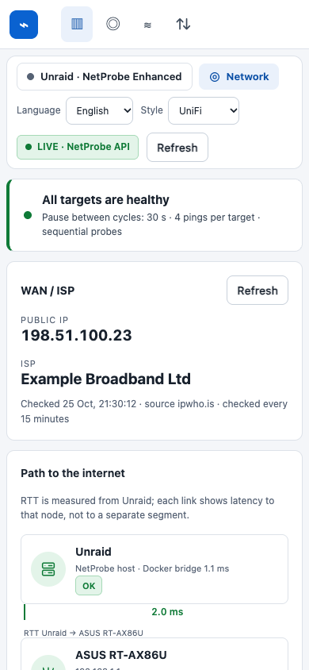
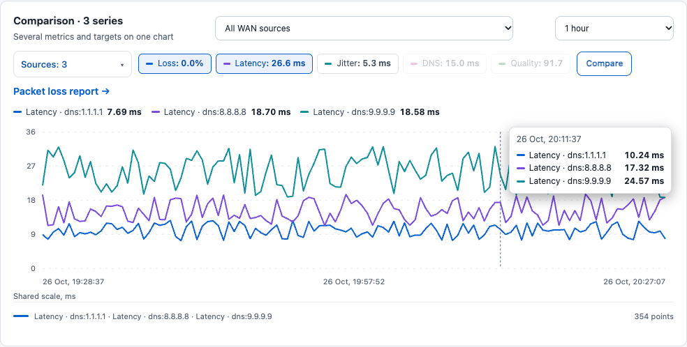
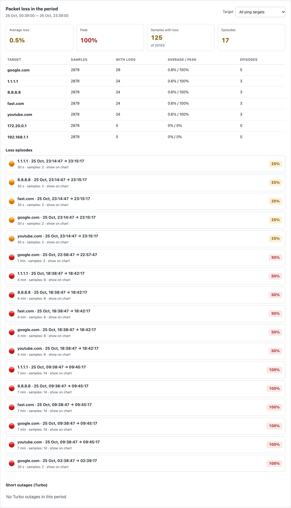
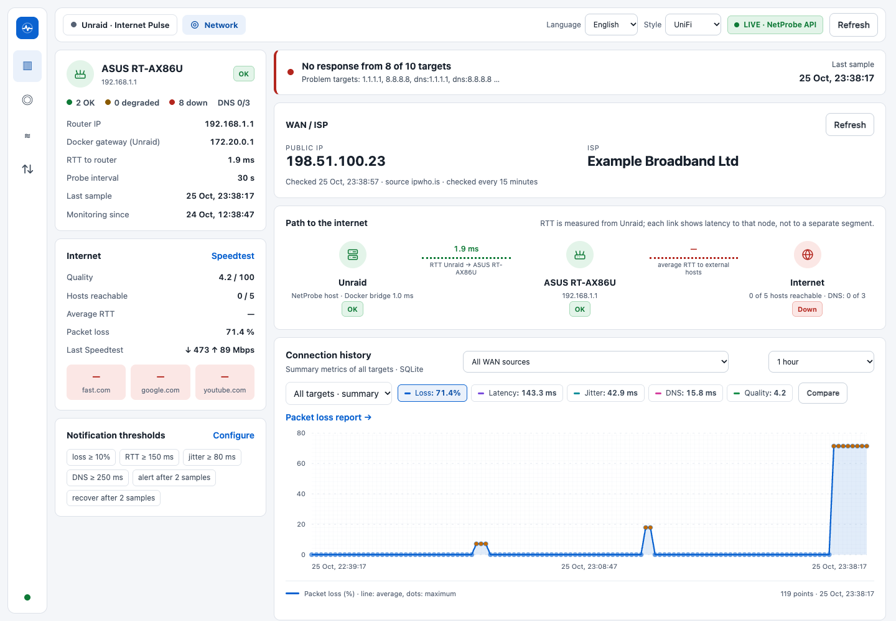

# NetProbe Enhanced

An extension for [NetProbe](https://github.com/bmartino1/NetProbe_Python) on Unraid: per-target history, a packet-loss
report and **readable Unraid notifications** (email / Telegram) for the NetProbe Docker container — plus a modern dashboard with two
styles (dark *NetProbe* and light/dark *UniFi*) and a Russian/English switch.

It is an **extension, not a fork of the container**: the original image stays untouched, and three files are
bind-mounted read-only over it. Removing the mounts brings the stock NetProbe back at any time.

> NetProbe Enhanced is an independent project and is not affiliated with or endorsed by the author of NetProbe.
> The screenshots show invented data (a fictional ASUS router at 192.168.1.1), generated by
> [`tests/demo_server.py`](tests/demo_server.py).

[Русская версия](README.ru.md)



| | |
|---|---|
|  |  |

## What you get

- **History per target and per measured IP** (SQLite, additive `np_*` tables — the upstream tables are never modified).
  The upstream app only keeps aggregates.
- **Alerts that explain themselves.** Instead of `google.com: DOWN`, the notification says what is wrong:
  *Router is not responding*, *No internet*, *Names do not resolve (DNS)*, *Unreachable: Google*, with icons,
  a hint what to check and, on recovery, how long the problem lasted. See [docs/NOTIFICATIONS.md](docs/NOTIFICATIONS.md).
- **No notification floods.** A change needs 2 consecutive bad samples; a steady outage sends one message, not
  one per probe; a target that keeps flapping is muted and summarised. 3 hours of flapping produce 5–6 messages
  instead of hundreds (see the simulator below).
- **Turbo mode (opt-in) for short outages.** A light watcher pings the router and two internet IPs every 5 s and
  reports outages from about 10 s that the regular checks miss: one message after recovery with the duration, at
  most 3 per hour, and silence when the regular monitor already alerted. Off by default; ⓘ in the settings explains it.
- **Scheduled Speedtest with a notification.** In the *Speedtest* tab: off, every N hours, or every day at set times
  (for example 03:00); optionally one Unraid message with the result (or the reason it failed) after every automatic
  test. Without changes the container variables `SPEEDTEST_ENABLED` / `SPEEDTEST_INTERVAL` keep deciding.
- **A *WAN / ISP* card with your external IP, on request.** Tick *Show my external IP and provider* in the settings
  and a card under the status banner shows the address the internet sees and your provider's name. Off by default:
  nothing is requested until you tick it; then the container asks `ipwho.is` (fallbacks `api.ipify.org`,
  `icanhazip.com`, which know the address only) at most once every 5 minutes. The service sees the address the
  request comes from.
- **Packet-loss report for any period** — summary, per-target table and a list of loss episodes; click an
  episode to zoom the chart onto it. Periods from 1 minute to a month, or a custom *from–to* window.
- **Compare mode** — several metrics and several targets (for example all DNS servers) on one chart, with a
  shared scale when the units match and a per-series scale otherwise.
- **Path to the internet:** Unraid → router → Internet, drawn from the real targets, with measured RTT on the links.
- **Speedtest service of your choice.** The *Speedtest* tab says which service measures: Speedtest.net (Ookla servers,
  through speedtest-cli — the default), the official Ookla CLI (when you install its binary in the container) or
  **Fast.com (Netflix)**, measured by NetProbe itself — no account, key or extra software. The choice applies to
  manual and scheduled tests and is stored in `/data/netprobe-prefs.json`.
- **Two UI styles, two languages** chosen from drop-downs (remembered in the browser). One self-contained HTML
  file: no CDN, no external fonts, works offline on your LAN.
- **Safe by construction:** NetProbe Enhanced sends nothing anywhere except through Unraid's own `notify`. The only
  outbound requests are the ones you ask for: the Speedtest you run or schedule (speedtest.net, Ookla or fast.com
  / Netflix servers, depending on the chosen service) and, only with the checkbox ticked, the public-IP / ISP lookup. The
  container gets no extra privileges, no Docker socket and no host mounts besides the three read-only files.





## How it works

```
 probe cycle (~50 s)            SQLite (/data)                 Unraid host
 ┌────────────────────┐   ┌────────────────────────────┐   ┌───────────────────────────────┐
 │ NetProbe container │──▶│ native tables (unchanged)  │   │ cron, every minute            │
 │  + netprobe_       │   │ np_targets  np_state       │   │ netprobe-unraid-notify.sh     │
 │    extensions.py   │   │ np_events   np_notifications│◀──│  GET /api/notifications/pending│
 │  + new index.html  │   └────────────────────────────┘   │  → Unraid `notify` (mail/TG)  │
 └────────────────────┘                                     │  → POST …/ack                 │
        ▲ web UI :8788                                      └───────────────────────────────┘
```

More detail: [docs/ARCHITECTURE.md](docs/ARCHITECTURE.md).

## Requirements

- Unraid with the **NetProbe** container from Community Applications (`bmmbmm01/netprobe`, SQLite backend).
- Unraid notifications configured (*Settings → Notification Settings*: email and/or Telegram agent).
- `curl`, `jq`, `flock`, `bash` on the host (all present on stock Unraid).

Tested with image `bmmbmm01/netprobe@sha256:386bdc2c177b11aef4a1223dfd91ae47fe2f9804c5449c5f4c2caae1d048c155`
(Python 3.14, Flask 3.1). Other image versions may need `src/app.py.patch` re-applied — see
[upstream/UPSTREAM.md](upstream/UPSTREAM.md).

## Install (short version)

**New install from scratch** (example `docker-compose.yml`, then three files in the data folder):
**[docs/INSTALL-COMPOSE.md](docs/INSTALL-COMPOSE.md)**. Converting an existing NetProbe container, with backup and rollback:
**[docs/INSTALL-UNRAID.md](docs/INSTALL-UNRAID.md)**.

1. Back up the container template and the database.
2. Copy `src/app.py`, `src/netprobe_extensions.py`, `src/index.html` to
   `/mnt/user/appdata/netprobe_database/custom/` and mount them **read-only** into the container at
   `/app/app.py`, `/app/netprobe_extensions.py`, `/app/templates/index.html`.
3. Pin the image by digest (so an automatic update cannot replace the base under the overrides).
4. Add the notification bridge: `src/netprobe-unraid-notify.sh` + one cron line
   ([`scripts/netprobe-notify.cron`](scripts/netprobe-notify.cron)).
5. Recommended container variables: `ROUTER_IP`, `ROUTER_NAME`, and **two IP targets in `SITES`**
   (for example `fast.com,google.com,youtube.com,1.1.1.1,8.8.8.8`). Pinging names depends on DNS; the IP targets let
   NetProbe tell "DNS is down" from "the internet is down".

## Upgrading from an earlier version

A new release changes only the three container files. The database, `alert-settings.json`, `notify-token`, the
bridge script and the cron line stay as they are, and no migration is needed (new tables and files are created on
first use). Back up the old files, copy the new ones into `…/custom/` and restart the container — the exact
commands, the check and the rollback are in **[docs/INSTALL-UNRAID.md → Updating NetProbe Enhanced](docs/INSTALL-UNRAID.md#updating-netprobe-enhanced)**.
What changed in each version: [CHANGELOG.md](CHANGELOG.md).

## Configuration

| Variable (container) | Meaning |
|---|---|
| `ROUTER_IP` | router address; becomes the *Router* node and the first thing blamed when it does not answer |
| `ROUTER_NAME` | label used in the UI and in notifications (default `Router`, e.g. `ASUS RT-AX86U`) |
| `SITES` | comma-separated ping targets; include 1–2 IP addresses besides names |
| `DNS_NAMESERVER_n` / `_IP` | DNS servers probed (existing upstream variables) |
| `PROBE_INTERVAL`, `PING_COUNT` | unchanged upstream behaviour (default 30 s, 4 pings) |
| `SPEEDTEST_ENABLED`, `SPEEDTEST_INTERVAL`, `SPEEDTEST_BACKEND` | upstream behaviour (`python`, `ookla`, and now `fast`); the *Speedtest* tab can override service and schedule, see [docs/NOTIFICATIONS.md](docs/NOTIFICATIONS.md) |
| `APP_TIMEZONE` | zone of the daily Speedtest times (default `UTC`) |
| `GUNICORN_CMD_ARGS` | `--threads 4` recommended: the stock image runs one single-threaded worker (see [docs/INSTALL-UNRAID.md](docs/INSTALL-UNRAID.md#web-server-threads-optional-recommended)) |

Alert thresholds (loss ≥ 10 %, RTT ≥ 150 ms, jitter ≥ 80 ms, DNS ≥ 250 ms, 2 samples to alert, 2 to recover) are
edited in the UI (*Notifications* tab / *Notification thresholds*) or in `/data/alert-settings.json`.

## Try it, test it, break it — without sending anything

```sh
python -m venv .venv && . .venv/bin/activate && pip install -r requirements.txt
python -m unittest discover -s tests          # unit + integration tests (real Flask app, real bridge script)
python tests/simulate_network.py -v           # real probe loop + queue + bridge on a virtual clock, fake ping/DNS
npm install && npx playwright install chromium && node tests/test_ui.cjs   # browser tests, both styles/languages
node tests/test_mobile_nav.cjs && node tests/test_speedtest_ui.cjs          # pinned menu on phones; Speedtest service, schedule, public IP
```

The simulator runs 20 failure scenarios (outage, DNS-only outage, router down, flapping, restarts, a dead
notifier, …) through the real code and a fake `notify`; **no real notification or network request is made**.
`CHROME_PATH=/path/to/chrome` makes the UI test use an installed browser.

To look at the dashboard without Unraid or a real network, run `python tests/demo_server.py` and open
<http://127.0.0.1:8799> (add `--failing` to end with an outage). It runs the real app on invented data;
`node tests/screenshots.cjs` regenerates the pictures in `docs/screenshots`.



*(Demo data with a simulated internet outage, to show the colours — not a real outage.)*

## Security notes

- NetProbe's web UI and API have **no authentication** (as upstream). Keep port 8788 on your LAN; do not expose it.
- The settings and preferences endpoints (`/api/settings`, `/api/prefs`) accept only same-origin browser requests with an `X-NetProbe-Request` header.
- The notification queue is private to the host: `X-NetProbe-Notify-Key` (a random 256-bit token generated on
  first start in `/data/notify-token`, mode 600) is required to read or acknowledge it.
- Do not commit `/data` contents (database, token, settings) anywhere; see `.gitignore`.

## Limitations

- Probes are sequential (unchanged upstream design): a cycle takes about 50 s when everything answers (pings, DNS
  checks, then a 30 s pause) and about 100 s during an outage, because every dead target waits for its timeout.
  A change must be seen in **two consecutive cycles**, so an outage shorter than about 1.5 minutes is never reported
  and one of about 2.5 minutes (plus up to a minute for the cron bridge) always is. Setting `confirm_samples` to 1
  in the thresholds lowers that to about 40 s at the price of alerts for single blips. **Turbo mode** (off by
  default) catches outages from about 10 s instead; it costs about 9 MB of ICMP per day, and an ISP that rate-limits
  ICMP to *all* internet targets at once can cause a false report (one lost echo or one silent host is never enough).
  Its message waits for the regular cycle that was running at recovery (up to about 1.5 min) so the same outage is
  never reported twice.
- **Fast.com** numbers come from NetProbe's own client (latency, 8 connections for 8 s down, 4 for 8 s up against the
  closest Netflix servers); they can differ from the fast.com page, so compare a service with itself over time.
  The Speedtest.net backend keeps its upstream unit conversion (Mbit/s ÷ 1.048576). A scheduled test uses real
  bandwidth for about 20 s.
- Fast.com has no documented public API: the client uses the same endpoints as the fast.com page. If Netflix changes
  them, a Fast.com test fails with a readable message (and, when notifications are on, a warning) and the other
  services keep working.
- If the internet and the LAN are both completely down, Unraid cannot deliver email/Telegram. An external watcher
  is needed for a full-site outage.
- Real delivery through the Unraid agents is exercised only by your first real event; automated tests use a fake `notify`.
- Not tested on other Unraid / NetProbe versions, and the GitHub Actions workflow has not been run yet.

## License and credits

MIT — see [LICENSE](LICENSE). `src/app.py` is a modified copy of NetProbe_Python by Brandon Martino (MIT);
notices in [THIRD_PARTY_NOTICES.md](THIRD_PARTY_NOTICES.md).
